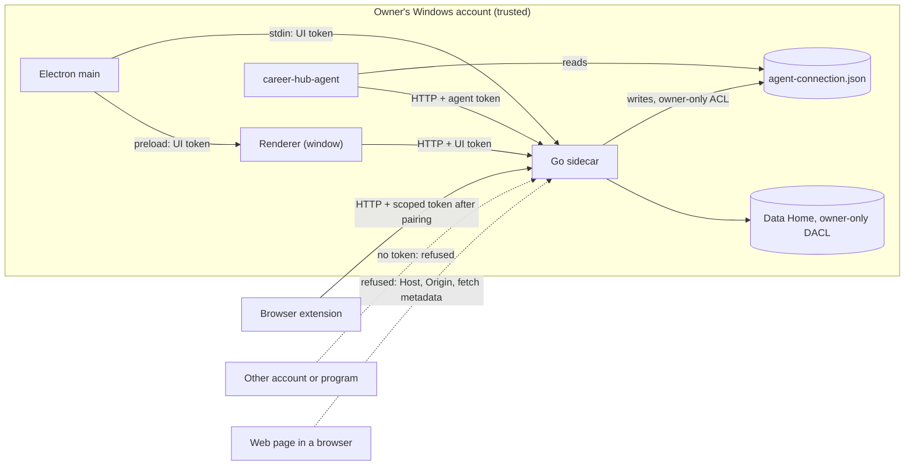

# SEC-250: Admit Only The Owner's Own Clients To The Local API

- **Status:** Accepted and implemented. All five items merged (2026-10-14);
  owner-run acceptance gate passed (2026-10-15)
- **Decision date:** 2026-10-14
- **Deciders:** project owner (approved 2026-10-14); drafted by Claude Code
- **Evidence tickets:** `CH-142`
- **Related:** [SEC-240](SEC-240_platform_secret_and_document_protection.md)
  (platform key stores), [DESK-030](DESK-030_desktop_shell.md) (desktop shell),
  [sidecar protocol](../reference/sidecar_protocol.md). Encryption of the Data Home is a
  separate, later decision (CORE-100).

## Context

The Go sidecar serves the UI and a local HTTP API on `127.0.0.1` at an
operating-system-assigned port. Any process on the machine, under any Windows
account, can open a TCP connection to that address while the app runs. On
Windows the loopback interface is shared by every logged-on session.

### Current admission, verified in code on 2026-10-14

| Caller | How it gets authority today | Evidence |
| --- | --- | --- |
| Desktop window (renderer) | `GET /api/session` returns the full capability token; the UI keeps it in memory and sends `X-Career-Hub-Token` | `src/intake_ui_static/ui/api.js:29,52`; `backend/internal/sidecar/httpapi/http.go` (`authorize`, `/api/session` case) |
| `career-hub-agent` | The same `GET /api/session` | `backend/internal/agentmaterials/client.go:138` |
| Browser extension | `POST /api/session` with `Origin: chrome-extension://<id>` returns scoped `capture` and `helper` tokens | `backend/internal/sidecar/httpapi/extension_boundary.go` (`authorizeExtension`) |

The token is 32 random bytes generated per sidecar start (`newHandler` in
`http.go`) and compared in constant time. The listener binds `tcp4
127.0.0.1` with `SO_EXCLUSIVEADDRUSE` (`runtime/listener_windows.go`), so
another process cannot take over the port.

**The weakness.** For `/api/session`, `authorize` requires a loopback `Host`, an
`Origin` that is empty or local, and a `Sec-Fetch-Site` that is not
`cross-site`. Browsers set `Origin` and `Sec-Fetch-Site` themselves, so these
checks constrain web pages, but a program chooses its own headers: it can omit
both and receive the token. The extension's `Origin` is likewise a header a
program can send, and the extension ID is fixed by the public key in
`extension/manifest.json`. The random port adds no real protection, because a
local scan of all ports takes seconds.

**Data Home files** are created with a protected DACL that grants only the
current user's SID and SYSTEM (`backend/internal/datahome/privacy`). An
existing Home keeps its ACLs and is not re-verified at startup
(`backend/internal/datahome/bootstrap.go`: "Existing initialized Windows homes
keep their ACLs"), so permissions loosened by a move, restore or another tool
would go unnoticed.

## Decision Drivers

1. No capability token is obtainable by a process that is not one of Career
   Hub's own clients running as the owner.
2. Keep every existing defense against web pages (DNS rebinding, CSRF).
3. Least privilege: each client gets only the authority its job needs.
4. Reuse existing mechanisms (stdin protocol, preload, DACL code) rather than
   add a new transport.
5. No regression for the owner: no new prompts in daily use beyond one-time
   extension pairing.

## Threat Model

Method: assets and trust boundary first, then each actor's entry point
classified with STRIDE (Spoofing, Tampering, Repudiation, Information
disclosure, Denial of service, Elevation of privilege) and rated by current
risk (likelihood × impact).

**Assets:** the Career Vault and application records; generated materials;
the capability tokens themselves; the extension's ability to write captured
jobs; the Gmail credential (held in Windows Credential Manager per SEC-240).

**Trust boundary:** the owner's Windows account. Code running as the owner
inside Career Hub's own processes (Electron main, the sidecar, the agent client
launched by the owner) is trusted. Everything else must prove it acts for the
owner.

| # | Actor | Entry point | STRIDE | Risk today | Today | Target |
| --- | --- | --- | --- | --- | --- | --- |
| T1 | Another standard Windows account on the same PC, while the app runs | TCP to `127.0.0.1:<port>`, `GET /api/session` | S, I, T, E | **High** | **Full read/write access** | Refused: no token is ever disclosed over HTTP |
| T2 | Another standard Windows account reading files | The Data Home folder | I, T | Low | Refused by the private DACL, but drift goes unnoticed | Refused, and startup fails closed if the DACL or owner is wrong |
| T3 | A malicious web page in the owner's browser | `fetch` to loopback; DNS rebinding | S, T, I | Low | Refused (`Host`, `Origin`, `Sec-Fetch-Site` checks) | Unchanged; keep these checks |
| T4 | A program impersonating the extension | `POST /api/session` with a forged `Origin` | S, T | Medium | Receives the scoped extension tokens | Refused: extension tokens come only from owner-approved pairing |
| T5 | A compromised or malicious browser extension | Its granted token | E, T | Medium | Not distinguished from the real one | Limited to `capture`/`helper` scope; revocable in Settings |
| T6 | A network attacker on the LAN | Network interfaces | I | Low | Refused (loopback-only listener) | Unchanged |

**Out of scope, stated honestly:**

- Malware already running under the owner's account (for example a malicious
  installer or dependency the owner started). Windows gives it the owner's
  permissions, so it can read the owner's files, screen and process memory; no
  local API design stops it. The owner remains fully trusted. Encryption with a locked
  vault (CORE-100) narrows what it can read while the app is locked.
- Administrators and SYSTEM. They can override DACLs and read any process.
  Protecting data at rest from them is the encryption decision, not this one.
- Physical access to an unlocked session.

## Decision

1. **The window's token comes from Electron, not from HTTP.** Electron main
   generates the 32-byte UI token and sends it to the sidecar in the startup
   record over the owned stdin pipe (an optional `session_token` field; the
   protocol stays at version 1, see the implementation note below). The renderer receives
   it through the existing frozen preload API, not through any HTTP route. This
   keeps the existing rule that the host never accepts a token from sidecar
   output (`sidecar_protocol.md`): the secret flows from the trusted parent to
   the child.
2. **`/api/session` stops disclosing secrets.** It returns only non-secret
   capability flags, or is removed. No HTTP route returns any token.
3. **The agent client reads an owner-only connection file.** At startup the
   sidecar writes `session/agent-connection.json` (address and a separate agent
   token) inside the Data Home, whose protected DACL admits only the owner and
   SYSTEM and whose `session/` directory backups never include. It is replaced
   at every start and removed at shutdown by size-and-hash-guarded deletion.
   Settings shows the file's path; `career-hub-agent --connection <path>` reads
   it. The agent token is scoped to the routes the agent client calls plus the
   read-only skills registry, and is refused when sent with browser headers.
   *Implementation note (2026-10-14):* the Electron profile folder was
   considered and rejected because it inherits the user profile's ACL, which on
   the development machine also granted read access to a sandbox-users group
   and full control to an orphaned SID. The Data Home's explicitly protected
   DACL does not depend on profile inheritance.
4. **The extension pairs once with a code shown in the app.** When the owner
   enables the extension in Settings, the app displays a short random code with
   a short expiry (the industry-standard device-pairing pattern; for example 8
   characters, valid for 5 minutes, single use). The extension submits it once and receives scoped
   `capture`/`helper` tokens that persist in extension storage until revoked in
   Settings. The `Origin` check stays as an additional layer. The extension
   endpoint stays off unless enabled.
   *Implementation note (2026-10-14):* the code is redeemed for one long-lived
   256-bit **pairing credential**, not for the scoped tokens themselves. The
   worker sends it on each `capture`/`helper` bootstrap, so those tokens stay
   per start and die with the process as before; only the credential persists
   (extension `storage.local`; Career Hub keeps its SHA-256 in the Data Home
   `session/` folder). Pairing is offered under Settings whenever the extension
   endpoint is enabled at launch; enabling it remains a launch option. Only the
   window token can create a code, see the status or revoke.
5. **Startup verifies the Data Home owner and DACL.** Every start runs the
   existing `VerifyPrivateTree` DACL predicate on the Home root (root only:
   constant time, and descendants inherit from it) and checks that the root's
   owner is the current user or the token's default owner. Windows Server and
   some policies make the Administrators group the default owner of objects an
   elevated administrator creates; administrators are already out of scope. On failure the sidecar refuses to
   start with a fixed code; repair is an explicit, confirmed action in Settings.

### Token lifecycle rules

- Generated from the operating system's cryptographic random source, 256 bits.
- UI and agent tokens are per sidecar start and die with the process; the UI
  token lives only in memory.
- The agent connection file is the only token written to disk: owner-only DACL,
  deleted at shutdown, replaced on every start.
- The extension pairing credential persists in extension storage until
  revoked or re-paired; revoking in Settings invalidates it immediately. The
  app stores only its SHA-256. Scoped extension tokens remain per start.
- Tokens never appear in URLs, logs, diagnostics, error messages, crash output
  or sidecar stdout, and are always compared in constant time.

*Implementation note for item 1 (2026-10-14):* bumping to protocol version 2
would change every record (ready, shutdown, health) and every harness that
checks them for one new value. The start record instead gains one optional
`session_token` field, strictly validated; the desktop always sends it.

Items 1–4 form the "API admission" change and item 5 the "Home owner check";
they are independent and can be implemented as two parallel PRs.

## Alternatives

| Option | Why not now |
| --- | --- |
| Named-pipe transport for the UI ("app-first") | Dropped by the owner on 2026-10-14 as unnecessary. Once item 1 lands no token travels over HTTP, so reaching the loopback port without a token yields nothing; a pipe would add a cross-cutting change for little gain. |
| Identify the caller's process from the TCP connection (`GetExtendedTcpTable`) | Racy and Windows-specific; a token handed over a private channel is simpler and testable. |
| Keep `/api/session` and add an `Origin` requirement | Programs forge headers; it would only move the weakness. |
| Native messaging for the extension | Rejected for v1 (2026-10-05): a second installed binary and registry entries for a smaller gain than pairing. |
| Cookies for the window | Sent automatically by browsers (ambient authority), which reintroduces CSRF risk; the explicit header token is preferable. |

## Consequences

- The sidecar protocol moves to version 2 (one new start-record field); the
  desktop and sidecar must upgrade together, which the package manifest already
  enforces.
- Rendered smoke tests that fetch `/api/session` must obtain the token the way
  the window does.
- The extension needs a one-time pairing UI in Settings and in the extension.
- Agent workflows pass `--connection <path>` (copied from Settings) instead of
  `--server`; `--server` remains a legacy option that must match the file.

## Rollout And Rollback

- The desktop host and sidecar ship together; the package
  manifest already refuses mismatched pairs.
- After the update the extension must be paired once; the release notes and
  the extension's error message say so.
- `career-hub-agent` takes its token only from the connection file once PR 3
  lands; until then `--server` alone still uses the legacy session bootstrap.
- Rollback is a normal downgrade to the previous release: no stored data format
  changes, and the connection file is transient.

## Residual Risk

Accepted by the owner on 2026-10-14: malware running under the owner's
account, administrators and SYSTEM, and physical access to an unlocked session
(see Out of scope). The local port remains reachable by other local processes,
but yields nothing without a token. Revisit if Career Hub ever serves more than
one Windows account per installation or exposes any non-loopback listener.

## Verification

- Unit tests: `GET`/`POST /api/session` with any header combination never
  returns a token; requests with the agent or extension token outside their
  scope are refused; a Home with an extra ACE or a foreign owner fails startup
  with the fixed code.
- **Acceptance gate (owner-run):** with the app running under the owner's
  account, a second standard Windows account on the same PC can neither obtain
  a token from any route nor read files in the Data Home.

*Result (2026-10-15): passed.* The owner created a standard account and ran a
PowerShell window as it with `runas` while the app ran under the owner's
account. Same command, before and after the change:

| Build | `curl.exe -i http://127.0.0.1:<port>/api/session` from the second account |
| --- | --- |
| Installed 0.2.0 | `200 OK` with a `token` in the body (threat T1 reproduced) |
| `main` at `3558bf3` | `403 LOCAL_API_ACCESS_DENIED`, no token |

Listing the Data Home from the second account returned `Access is denied`.
Windows already denies other users the owner's profile folder, so that result
alone does not isolate the Data Home's own DACL; the owner-side check the same
day did: `%LOCALAPPDATA%\CareerHub\dev` is owned by the owner, has inheritance
protected, and grants access only to the owner and `SYSTEM`.

## References

- [OWASP: Cross-Site Request Forgery](https://owasp.org/www-community/attacks/csrf)
- [DNS rebinding](https://en.wikipedia.org/wiki/DNS_rebinding)
- [Fetch metadata request headers](https://developer.mozilla.org/en-US/docs/Glossary/Fetch_metadata_request_header)
- [Windows security identifiers](https://learn.microsoft.com/en-us/windows-server/identity/ad-ds/manage/understand-security-identifiers)
- [Socket `SO_EXCLUSIVEADDRUSE`](https://learn.microsoft.com/en-us/windows/win32/winsock/using-so-reuseaddr-and-so-exclusiveaddruse)
