# Career Hub Architecture Atlas

This atlas is the shared map of the implemented Career Hub system for users,
maintainers, and coding agents. It explains where data lives, which records are
authoritative, how the major workflows cross trust boundaries, and how the
stored models relate. It describes current behavior; it does not authorize a
future cloud service, scraper, AI provider, or automatic submission feature.

Use this document for orientation, then follow the linked contract or source
file for field-level behavior:

- [Architecture decisions](architecture.md)
- [Schema reference](schema_reference.md)
- [Current system pipeline](system_pipeline.md)
- [SQLite application history](application_history.md)
- [Data Home and recovery](data_home.md)
- [Native sidecar protocol](sidecar_protocol.md)
- [Job Feed, extension, and email plan](../product/job_discovery_capture_plan.md)
- [Agent workflow adapter](../guides/agent_workflows.md)
- [Manual acceptance paths](../guides/manual_testing.md)

The implementation is the final authority. The main model sources are
[`backend/internal/vaultread/validate.go`](../../backend/internal/vaultread/validate.go),
[`backend/internal/jobcard/validate.go`](../../backend/internal/jobcard/validate.go),
[`backend/internal/applications/schema/steps_generated.go`](../../backend/internal/applications/schema/steps_generated.go), and the typed
models linked below.

## How to read the atlas

Career Hub has four materially different forms of state. Keeping them separate
prevents the most common architecture mistakes.

| State kind | Meaning | Examples |
| --- | --- | --- |
| Canonical | Human-reviewed facts or configuration that future work may reuse | Career Vault YAML, private Skills Registry overlays |
| Transactional | Mutable workflow history with revisions and append-only events | SQLite application, discovery, email, contact, and session records |
| Retained source or audit | Exact input or a review trail; not automatically canonical | raw resumes, retained JDs, extraction/review/approval artifacts, discovery captures |
| Derived or ephemeral | Rebuildable output or in-memory/browser-only state | assessments, evidence/demand projections, rendered exports, capability tokens, UI filters |

In ER diagrams, `||` means exactly one, `o|` means zero or one, `|{` means one
or more, and `o{` means zero or more. The conceptual diagrams cross file and
database boundaries. The physical ER diagrams represent the SQLite v27 schema;
their entity labels use the exact table names.

## 1. System context and trust boundaries

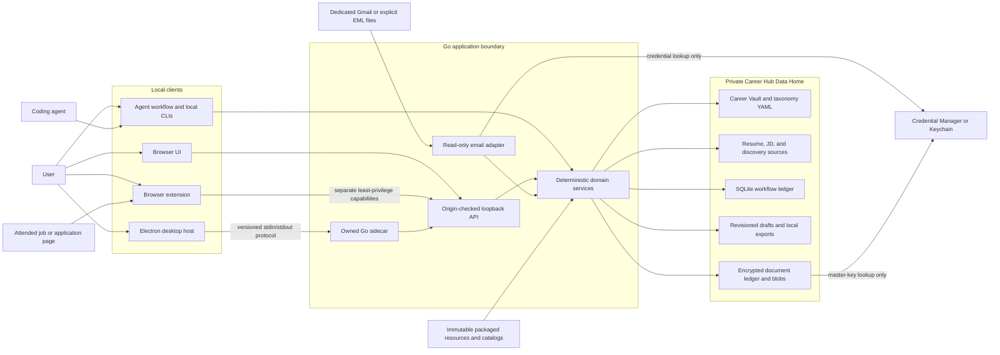

The entire product boundary is local. The browser and extension never own
business rules, and Electron never owns candidate data. The extension receives
different purpose-specific capabilities for capture, application assistance,
and attended submission tracking. It cannot turn one capability into a general
Career Vault or application reader. The email connector is receive-only; there
is no SMTP path. No repository module calls an AI API.

## 2. Component responsibility UML

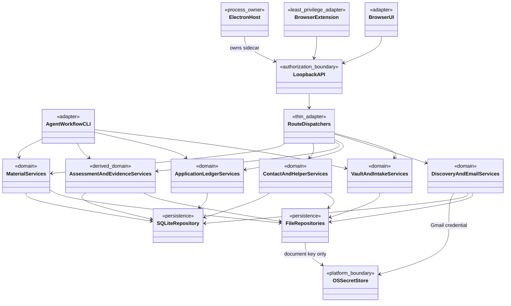

The dependency direction is intentional: adapters delegate to domain services;
domain services own validation, identity, state transitions, and idempotency;
persistence modules store already-validated state. Route handlers do not own
evidence, matching, document, or promotion logic.

## 3. Storage topology and ownership

```mermaid
flowchart TB
  ROOT["Selected Data Home"]
  ROOT --> CV["career_vault"]
  ROOT --> JOBS["jobs"]
  ROOT --> APPS["applications"]
  ROOT --> OUT["outputs"]
  ROOT --> DOCS["documents"]
  ROOT --> OPS["logs, backups, security-reports, secrets"]

  CV --> CV_FACTS["Canonical facts and policies in YAML"]
  CV --> CV_TAX["Private vocabulary overlays"]
  CV --> CV_RAW["Raw resume sources and intake audit runs"]

  JOBS --> JD_RAW["Immutable incoming JDs"]
  JOBS --> JD_CARD["Validated normalized job cards"]
  JOBS --> DISC_SRC["Retained discovery source snapshots"]

  APPS --> DB["career_hub.sqlite3"]
  APPS --> RESUME_BYTES["Immutable Resume Version bytes"]

  OUT --> DRAFTS["Revisioned resume and cover-letter YAML"]
  OUT --> EXPORTS["Derived DOCX, PDF, and TXT"]

  DOCS --> DOC_LEDGER["AES-GCM encrypted ledger"]
  DOCS --> DOC_BLOBS["AES-GCM encrypted PDF and image blobs"]

  RES["Packaged resource root"] --> CATALOGS["Core catalogs, UI assets, templates, fonts"]
  MEMORY["Process and browser memory"] --> TOKENS["Capabilities, review tokens, unsaved forms"]
  BROWSER_STORAGE["Browser local or session storage"] --> PREFS["Presentation preferences and bounded session metadata"]
```

| Owner and path | Stored model | Authority and mutation rule |
| --- | --- | --- |
| `career_vault/profile.yaml` | singleton candidate profile | Canonical after validated save; optimistic file revision |
| `career_vault/visa_profile.yaml` | confirmed eligibility facts | Canonical private facts; unknown remains unknown |
| `career_vault/education.yaml` | schools and certifications | One aggregate and one shared revision |
| `career_vault/experience_blocks.yaml` | experience records | Canonical evidence; archive is reversible |
| `career_vault/project_blocks.yaml` | project records | Canonical evidence with optional Experience links |
| `career_vault/skill_blocks.yaml` | skill-family records | Canonical organization and evidence links; distinct from the registry taxonomy |
| `career_vault/proof_blocks.yaml` | traceable reusable claims | Canonical claim index; every item names one source block |
| `career_vault/style_rules.yaml` | writing, ATS, selection, and quality rules | Canonical configuration, not generated prose |
| `career_vault/taxonomy/*.yaml` | private skill groups and skills | Canonical vocabulary overlay; vocabulary is never candidate evidence by itself |
| `career_vault/hard_blocker_policy.yaml` | enabled deterministic conflict classes | Private revisioned policy; advisory only |
| `career_vault/application_helper.yaml` | enabled helper field ids | Private allowlist; contains no projected values |
| `career_vault/application_answers.yaml` | explicitly saved safe short answers | Lazy, private, revisioned; excluded categories are never stored |
| `career_vault/raw/` and `career_vault/intake_runs/` | raw sources, extraction, review, approval result | Source/audit trail; no canonical write before approval apply |
| `jobs/incoming/` | exact retained JD text | Immutable source used by normalized cards |
| `jobs/normalized/` | validated normalized job YAML | Analyzed source record; assessment and application stage remain separate |
| `jobs/discovery/` | exact retained discovery text | Private source snapshot referenced by SQLite discovery rows |
| `applications/career_hub.sqlite3` | all high-churn workflow records | Transactional source of truth; schema v27, revisions, append-only events |
| `applications/resumes/library/` | immutable Resume Version bytes | Addressed by private SQLite metadata and integrity hash |
| `outputs/application_materials/<job-id>/` | typed resume and cover-letter drafts plus exports | YAML draft is editable truth; exports are rebuildable derivatives |
| `documents/` | encrypted metadata ledger and encrypted blobs | Narrow AES-GCM at-rest boundary; key is stored by the OS, not in the Data Home |
| `logs/`, `backups/`, `security-reports/` | operational evidence and recovery artifacts | Private local operations; never candidate evidence |
| `src/data/` and packaged assets | core catalogs and immutable resources | Product-owned read-only input; not copied into private facts |
| process/browser memory | capability tokens, one-shot review tokens, unsaved state | Ephemeral; never a durable source of truth |

## 4. Conceptual Career Vault model

This is a cross-file model. It is not a SQL schema. `REGISTRY_SKILL` represents
the effective merged core plus private Skills Registry; active Experience,
Project, and Certification records cite it through `competency_ids`.
`SKILL_FAMILY_RECORD` represents the separate legacy-compatible records in
`skill_blocks.yaml`.

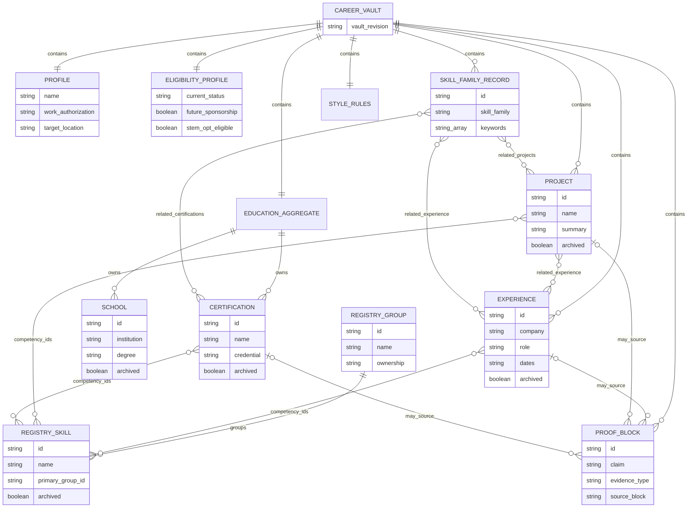

Each `PROOF_BLOCK` resolves to exactly one Experience, Project, or Certification
source according to `evidence_type`; the three optional diagram edges express
that polymorphic rule. Archived evidence remains valid for history but is
excluded from new active projections. A registry name, alias, or job
requirement never becomes proof merely by matching text.

## 5. Conceptual job-to-application model

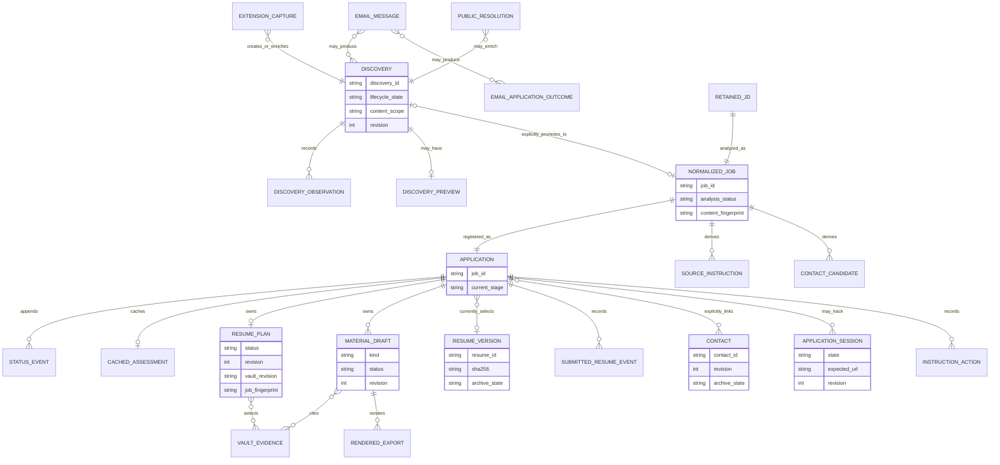

Three states that look similar in the UI are deliberately independent:

- normalized job `draft` / `ready` describes source-analysis review;
- Discovery `inbox` / `shortlisted` / `dismissed` / `promoted` describes an
  opportunity candidate before ledger promotion;
- application stage describes the user's saved/application history.

An assessment is cached derived data, not a fourth workflow state.

## 6. Physical SQLite ERD

The application database is owned only by
[`backend/internal/applications/schema/steps_generated.go`](../../backend/internal/applications/schema/steps_generated.go). It currently has
32 tables at schema version 27. The diagrams show every table and every
declared parent relationship, split into three bounded contexts so each remains
readable. Attribute boxes show the key, state, revision, and integrity anchors;
the schema owner remains the exact source for every scalar column and check
constraint.

### 6.1 Applications, assessments, and Resume Versions

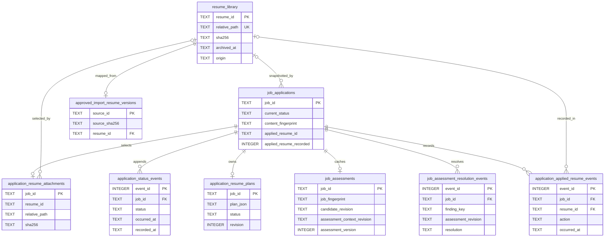

`application_resume_attachments.resume_id` and
`job_applications.applied_resume_id` were added to migrated tables and are
protected by database triggers rather than declared foreign-key clauses.
Deletion guards prevent a referenced Resume Version from disappearing.

### 6.2 Discovery and email intake

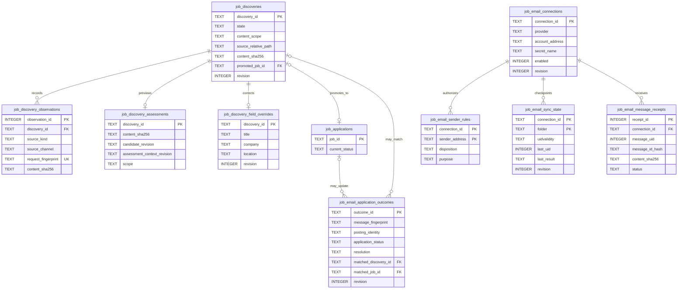

An email message receipt and an email application outcome share minimized
message identity but intentionally have no foreign key. One transport message
may yield independent opportunity discoveries and application outcomes. The
database never stores the Gmail App Password or the original message body.

### 6.3 Attended sessions, instructions, contacts, and reusable answers

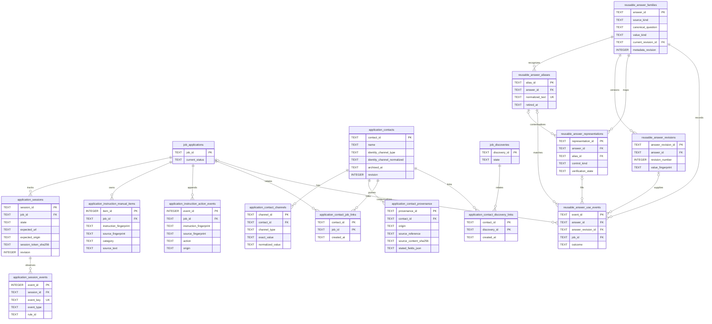

Contact provenance is append-only. Its `job_id` and `discovery_id` snapshot
fields are historical text, not foreign keys; deleting or unlinking a source
therefore cannot erase provenance. The two link tables are the live relational
edges. Instruction action events likewise refer to a stable instruction and
source fingerprint rather than mutating the detected or user-selected evidence.
Reusable answer revisions and use events are immutable audit records. A family
may instead resolve a current canonical profile field, so its use event stores
either an answer revision or a canonical source revision, never both.

### 6.4 Complete table index

| Bounded context | Exact table | Purpose | Change model |
| --- | --- | --- | --- |
| Application | `job_applications` | one current ledger row and JD snapshot per job | mutable current state plus guarded snapshot fields |
| Application | `application_status_events` | dated stage and note history | append-only |
| Application | `job_assessments` | current deterministic assessment cache | replace when source/context revision changes |
| Application | `job_assessment_resolution_events` | user handling of one assessment finding | append-only |
| Resume | `resume_library` | immutable Resume Version metadata | add; reversible archive; guarded delete when unused |
| Resume | `application_resume_attachments` | current Resume Version selection per application | replace or clear |
| Resume | `application_applied_resume_events` | initial and corrected submitted-resume history | append-only |
| Resume | `application_resume_plans` | one revisioned selection plan per application | optimistic replace |
| Resume | `approved_import_resume_versions` | idempotent approved-source-to-version mapping | one-to-one mapping |
| Discovery | `job_discoveries` | effective opportunity record, content identity, lifecycle, promotion | optimistic revision |
| Discovery | `job_discovery_observations` | producer provenance and idempotent request receipt | append-only |
| Discovery | `job_discovery_assessments` | current complete-content preview | replace when assessment inputs change |
| Discovery | `job_discovery_field_overrides` | explicit title/company/location corrections | optimistic replace; all-null row may remain |
| Email | `job_email_connections` | receive-only Gmail configuration without the secret value | optimistic revision |
| Email | `job_email_sender_rules` | exact sender allow/disable and stream purpose | composite-key upsert |
| Email | `job_email_sync_state` | UID cursor, lease, retry, and result per folder | optimistic checkpoint |
| Email | `job_email_message_receipts` | content-minimized idempotency and retry receipt | update one mailbox message identity |
| Email | `job_email_application_outcomes` | explicit status evidence and optional application/discovery resolution | idempotent record plus optimistic link resolution |
| Session | `application_sessions` | exact URL, tab, Origin, token-hash, and review state | constrained state transitions with revision |
| Session | `application_session_events` | minimal paired submit/success signal | append-only and event-key idempotent |
| Instruction | `application_instruction_manual_items` | exact user-selected missed instruction evidence | immutable unique evidence |
| Instruction | `application_instruction_action_events` | pending/done/not-applicable history | append-only |
| Contact | `application_contacts` | canonical stated identity and archive state | optimistic revision |
| Contact | `application_contact_channels` | exact email, phone, or professional-profile channels | transactional child records |
| Contact | `application_contact_provenance` | immutable source and stated-field snapshot | append-only, trigger protected |
| Contact | `application_contact_job_links` | optional many-to-many contact/application link | explicit link or unlink |
| Contact | `application_contact_discovery_links` | optional many-to-many contact/discovery link | explicit link or unlink |
| Reusable answer | `reusable_answer_families` | reviewed answer identity, source mode, and current revision pointer | optimistic metadata revision; reversible archive |
| Reusable answer | `reusable_answer_aliases` | exact normalized question variants | add or retire |
| Reusable answer | `reusable_answer_revisions` | immutable literal answer values | append-only, trigger protected |
| Reusable answer | `reusable_answer_representations` | reviewed control- and option-specific mappings | add, revise metadata, or retire |
| Reusable answer | `reusable_answer_use_events` | fill, copy, revert, and failure history | append-only, trigger protected |

## 7. Stored non-SQL model UML

### 7.1 Resume source intake artifacts

The intake models are defined by
[`backend/internal/vaultread/intake_validation.go`](../../backend/internal/vaultread/intake_validation.go) and
[`backend/internal/vaultread/setup_import.go`](../../backend/internal/vaultread/setup_import.go).
Each new run keeps its source-specific artifacts under
`career_vault/intake_runs/<source-id>/`.

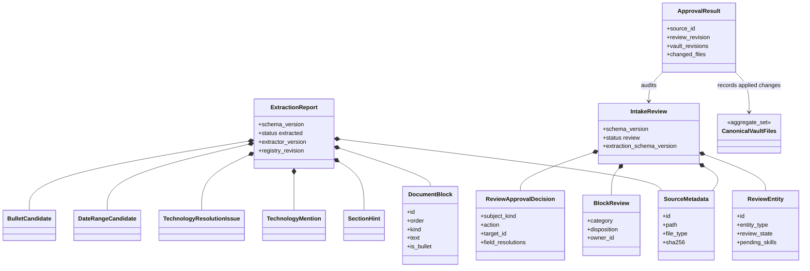

`extracted.yaml` is deterministic source analysis. `review.yaml` is an editable
draft. `approval_result.yaml` is an audit receipt. Only the rollback-capable
approval transaction may update canonical Vault files and private taxonomy.

### 7.2 Normalized job card

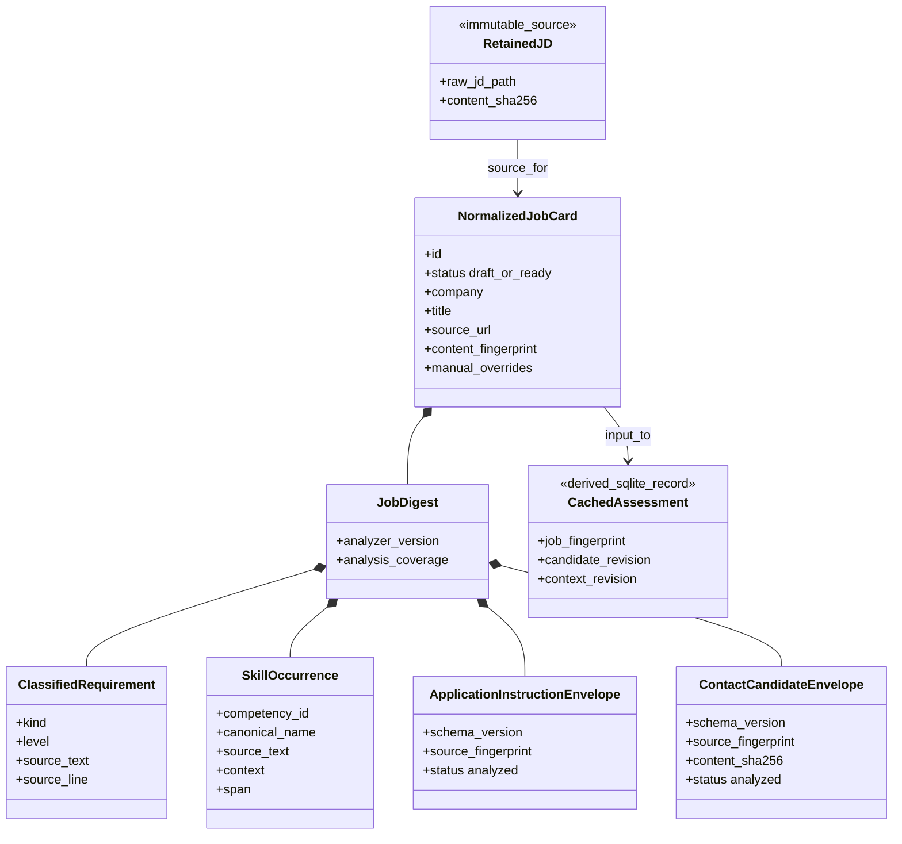

The card preserves source-backed analysis and explicit corrections. Mutable
instruction completion, contact identities, application stage, and assessment
resolution do not live in the card. A `ready` card requires enough reviewed
identity and requirement data; it does not mean “good fit” or “applied.”

### 7.3 Resume plan and application materials

The selection plan is JSON inside SQLite. The typed drafts are revisioned YAML
under `outputs/application_materials/<job-id>/`. Rendered files are derived.

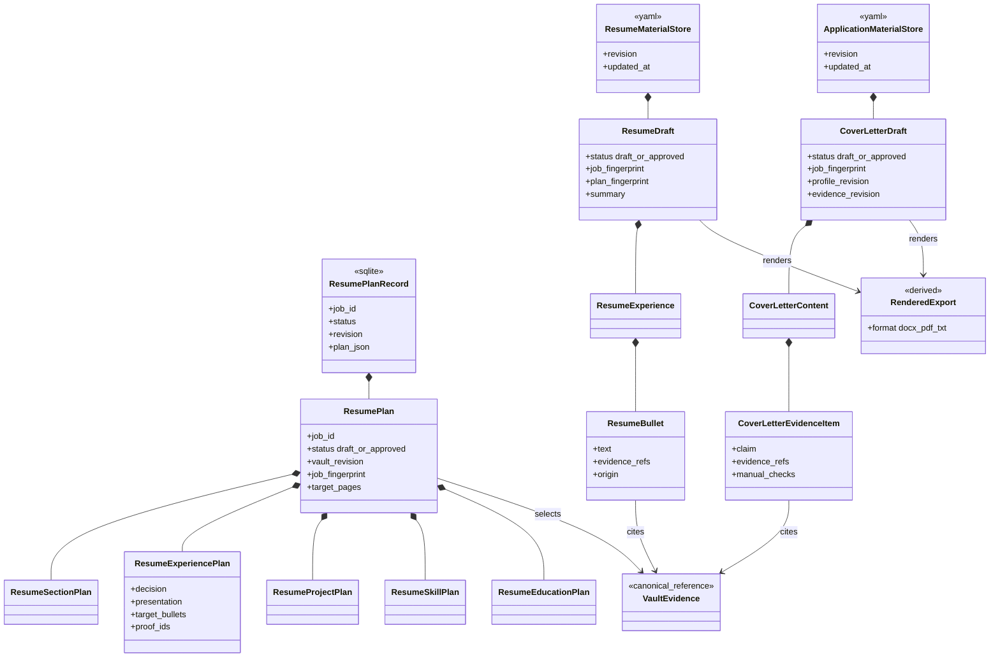

An approved plan is a source selection, not a generated resume. A material
draft is application-only wording, not Career Vault evidence and not an
immutable Resume Version. An exported file becomes a Resume Version only
through a separate explicit save/select action.

## 8. State contracts

### 8.1 Discovery lifecycle

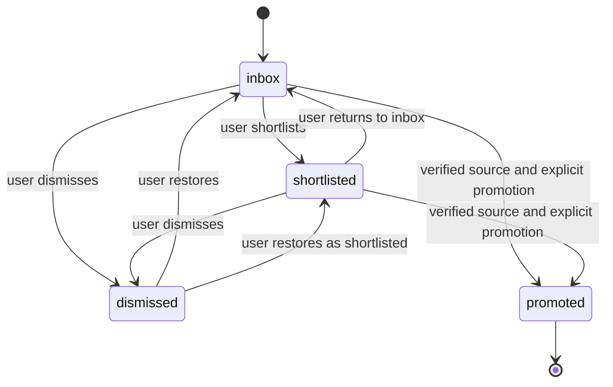

`promoted` is terminal and stores one unique `promoted_job_id`. Content
readiness is derived from retained source scope and verification; it is not a
second persisted lifecycle controlled by the user.

### 8.2 Application stages

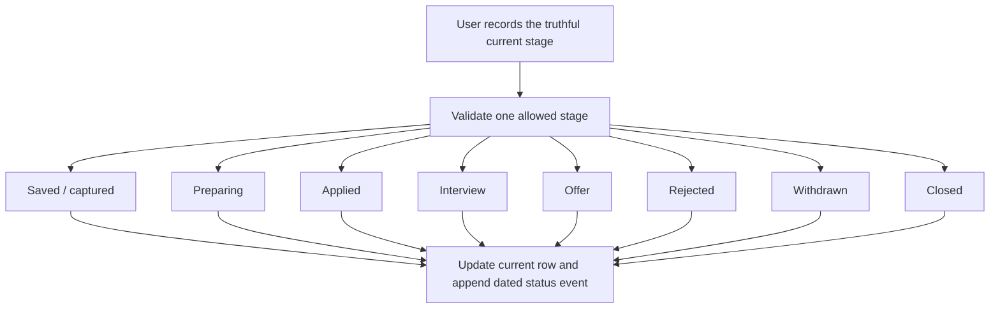

The repository intentionally does not force a linear stage sequence. `reviewed`
is retained only for legacy compatibility and is not a normal browser write.
The first Applied/Interview/Offer recording also preserves the submitted-resume
snapshot without inventing a missing Applied event.

### 8.3 Attended application session

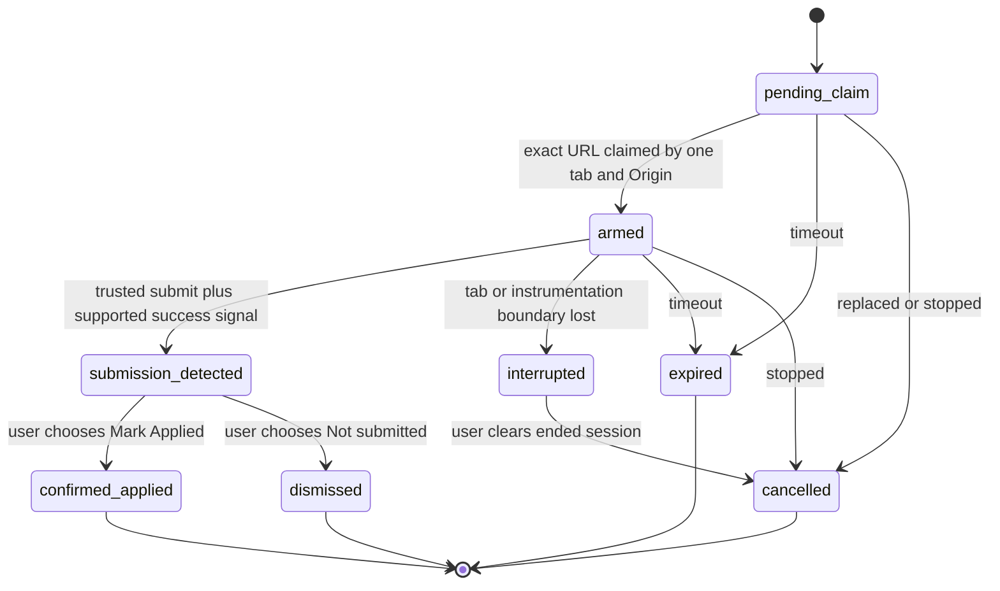

The signal is a review request, not proof by itself. Only
`confirmed_applied` delegates to the normal application-stage transition.

### 8.4 Resume intake approval

These are workflow milestones derived from files and validation, not a single
database status column.

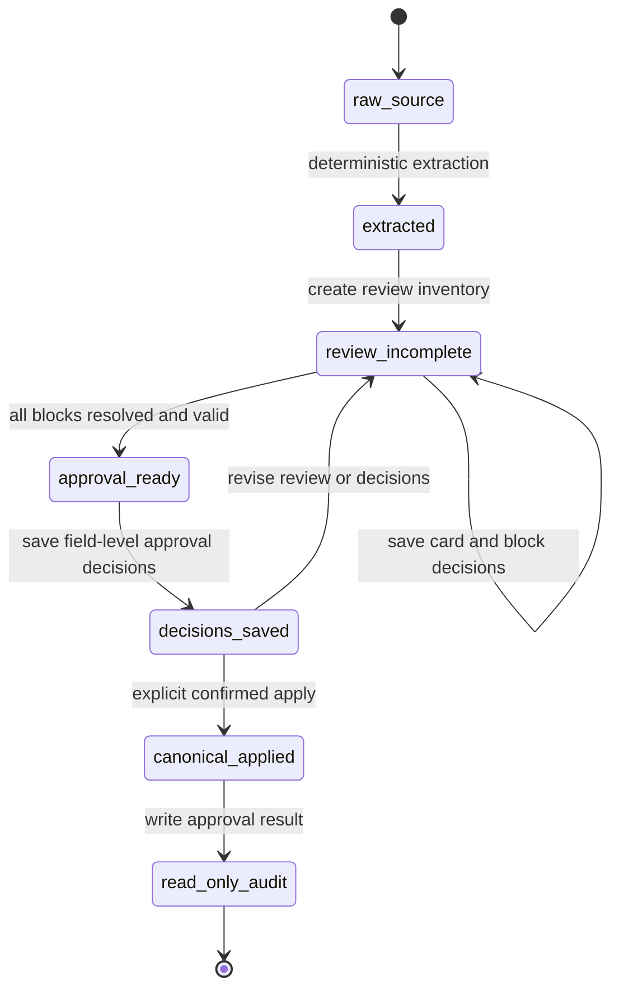

Repeated analysis creates a new run; it never overwrites an older review or
approved Career Vault state.

## 9. Workflow UML

### 9.1 End-to-end human workflow


Every match and blocker conclusion is advisory. The user can continue, save,
or record an application regardless of the assessment. Final attachment,
submission, and visual document review remain human actions.

### 9.2 Resume source to canonical Career Vault

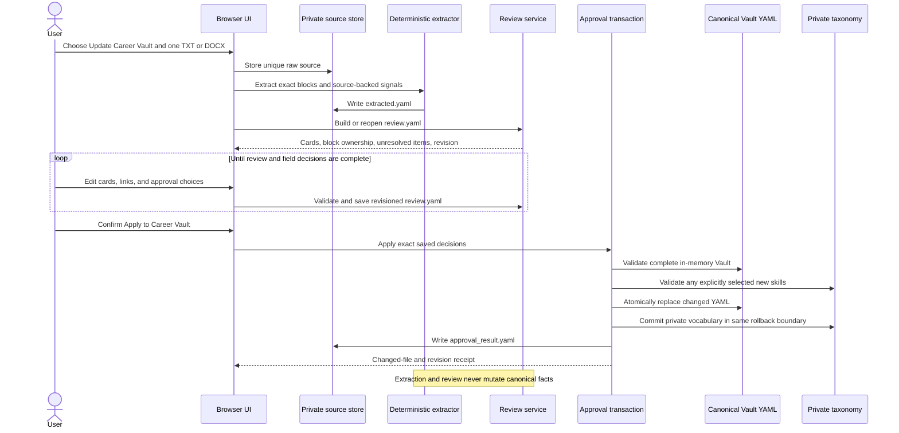

### 9.3 Job Feed capture, verification, and promotion

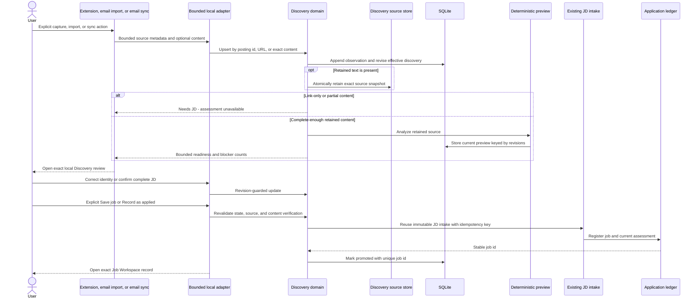

Capturing, opening, correcting, shortlisting, dismissing, or previewing never
creates an application. Promotion happens only after complete-source
verification and a separate user confirmation.

### 9.4 Email: one transport, two typed outputs

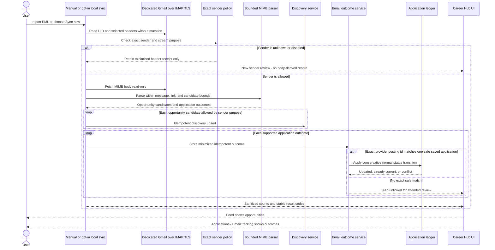

This split is the key Job Feed/email rule. A LinkedIn rejection message may
produce one rejection outcome and separate recommended-job discoveries. A
Handshake confirmation may produce one unlinked Applied outcome and separate
recommendations. Company-only confirmation never creates or guesses a role,
job, application, or contact. The connector does not mark mail read, move it,
delete it, send it, or retain the App Password in SQLite.

### 9.5 Assessment, preparation, materials, and application history

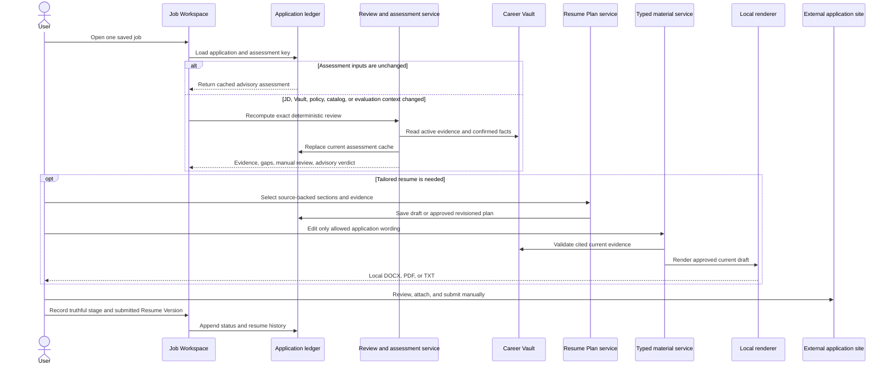

The Resume Version picker, Resume Plan, material draft, rendered export, and
submitted-resume event are separate records. Selecting or rendering a file does
not imply it was submitted.

### 9.6 Application helper and attended submission tracking

```mermaid
sequenceDiagram
  actor User
  participant Extension as Browser extension
  participant API as Purpose-specific local API
  participant Helper as Helper domain
  participant Page as Current application page
  participant Sessions as Application session domain
  participant Ledger as Application ledger

  User->>Extension: Open Application helper
  Extension->>API: Bootstrap helper capability for exact Origin
  API->>Helper: Build enabled, present value projection
  Helper-->>Extension: Masked shelf metadata in memory
  User->>Extension: Review profile fields on page
  Extension->>Page: Inspect supported visible empty controls
  Page-->>Extension: Labels, kinds, and opaque targets only
  Extension-->>User: Review proposals without values
  User->>Extension: Fill selected fields
  Extension->>API: Redeem one-shot review token and selected mapping ids
  API->>Helper: Re-fetch current projection and revision
  Extension->>Page: Revalidate all targets, then fill atomically
  Note over Extension,Page: No navigation, upload, consent, or submit click

  User->>Extension: Track submission on exact saved-job URL
  Extension->>Sessions: Claim one URL, tab, and Origin-bound session
  Sessions-->>Extension: Ephemeral per-session capability
  Extension->>Sessions: Send paired native-submit and visible-success signal
  Sessions-->>User: Queue submission confirmation
  alt User chooses Mark Applied
    User->>Sessions: Confirm current revision
    Sessions->>Ledger: Reuse normal Applied transition
  else User dismisses or tracking is interrupted
    Sessions-->>Ledger: No stage change
  end
```

Helper values remain outside extension storage. Passwords, one-time codes,
financial data, uploads, consent, open-ended answers, demographic controls, and
non-empty controls are outside reviewed prefill. Explicitly enabled voluntary
US demographic answers remain available only through one-field Copy. Submission tracking stores
only minimal rule and timestamp evidence, never DOM, form values, cookies,
credentials, or screenshots.

### 9.7 Desktop sidecar lifecycle

```mermaid
sequenceDiagram
  actor User
  participant Host as Electron host
  participant Sidecar as Packaged Go sidecar
  participant DataHome as Selected Data Home
  participant API as Loopback server
  participant Window as Electron renderer

  User->>Host: Launch Career Hub
  Host->>Sidecar: Spawn exactly one owned child with only sidecar flag
  Host->>Sidecar: Send bounded versioned start record over stdin
  Sidecar->>DataHome: Validate resource/data separation and initialize schemas
  Sidecar->>API: Bind OS-assigned 127.0.0.1 port
  Sidecar-->>Host: Emit one path-free ready record with port
  Host->>API: Verify minimal health contract
  Host->>Window: Load only the constructed owned loopback origin
  Window->>API: Obtain separate memory-only browser session capability
  User->>Host: Quit
  Host->>Sidecar: Send versioned shutdown record
  Sidecar->>API: Stop listener
  Sidecar-->>Host: Exit cleanly
  Note over Host,Sidecar: Parent-pipe closure also stops the child
```

Resource paths, data paths, tokens, and ports do not travel in process
arguments or inherited environment variables. The desktop wrapper is a host,
not another backend or synchronization layer.

### 9.8 Agent-assisted application workflow

```mermaid
sequenceDiagram
  actor User
  participant Skill as Career Hub repo skill
  participant CLI as agent_workflow CLI
  participant Domain as Existing deterministic services
  participant Agent as Language-model reasoning
  participant Materials as Typed material service
  participant Renderer as Local renderer
  participant Ledger as Application ledger

  User->>Skill: Ask for assessment, resume delta, or application text
  Skill->>CLI: Invoke the matching bounded command and typed task request
  CLI->>Domain: Resolve one Data Home and current source revisions
  Domain-->>CLI: Purpose-specific evidence and context
  CLI-->>Agent: Capped packet, fingerprints, limits, and no-forcing policy
  Agent-->>User: Evidence-backed judgment or copy-ready text
  opt User requested a durable resume or cover-letter artifact
    Agent->>CLI: Save typed material draft
    CLI->>Materials: Validate allowed fields and evidence references
    Agent->>CLI: Render requested format
    CLI->>Renderer: Render and structurally validate current draft
    Renderer-->>User: Local artifact
  end
  opt User confirms an external submission already happened
    Agent->>CLI: record-submission with explicit confirmation
    CLI->>Ledger: Append truthful application history
  end
```

The adapter performs no model call itself. Ephemeral `analyze` writes nothing;
`prepare` stops at Preparing; saving a draft does not attach, submit, or mark
Applied. Agents should use the bounded packet and open a source artifact only
for a specific unresolved fact.

## 10. Read-only evidence, demand, and coverage projections

```mermaid
flowchart LR
  VAULT["Active Career Vault records with explicit competency_ids"]
  REGISTRY["Effective core plus private Skills Registry"]
  JOBS["Validated normalized job cards"]
  LEDGER["Saved-job ledger rows and captured dates"]

  VAULT --> GRAPH["Candidate Evidence Graph"]
  REGISTRY --> GRAPH
  GRAPH --> ANALYTICS["Evidence Analytics"]

  JOBS --> DEMAND["JD Demand Index"]
  LEDGER --> DEMAND
  REGISTRY --> DEMAND

  ANALYTICS --> COVERAGE["Coverage Matrix"]
  DEMAND --> COVERAGE
  COVERAGE --> GAPS["Demand and coverage browser projection"]
  GRAPH --> EXPLORER["Competency Explorer projection"]
  REGISTRY --> EXPLORER

  GAPS --> UI1["Jobs / Demand and coverage"]
  EXPLORER --> UI2["Career Vault / Skills / All skills"]
```

These JSON models are calculated on demand and carry deterministic revisions
plus `read_only: true`. They are not caches, graph-database records, scores, or
Career Vault writers. The demand index counts only validated normalized cards
already present in the application ledger and deduplicates non-empty JD
fingerprints. Coverage uses only `supported`, `thin_evidence`,
`evidence_not_found`, and `not_requested`; absence means only **Evidence not
found in Career Vault.**

## 11. Human and system responsibility matrix

| Workflow | User-owned decision | Deterministic system responsibility | Must never be inferred |
| --- | --- | --- | --- |
| Career Vault edit | whether a fact is true and should be saved | validate complete affected aggregate, preserve metadata, reject stale writes | a missing career fact or credential |
| Resume source intake | card ownership and exact field-level approval | preserve source, extract bounded signals, apply only saved decisions | automatic canonical promotion |
| Job discovery | shortlist/dismiss, source verification, promotion intent | dedupe conservatively, retain provenance, block incomplete promotion | that a link/snippet is a complete JD |
| Email intake | sender allowlist, stream purpose, optional outcome link | receive-only parse, split opportunities/outcomes, keep idempotent receipts | role/application identity from company alone |
| Job assessment | whether to proceed and how to resolve findings | exact-source deterministic analysis with current candidate facts | a workflow prohibition or overall fit score |
| Resume Plan | source evidence and section selection | enforce current references and approval completeness | generated prose or submitted file |
| Material draft | final factual wording and visual approval | constrain fields, validate evidence, render locally | Career Vault mutation or external attachment |
| Application helper | each Copy, Review, Fill, or answer-bank action | purpose-limit values, revalidate targets, keep tokens one-shot | consent, credentials, sensitive answers, navigation, or submit |
| Submission tracking | whether the observed result means Applied | bind exact URL/tab/Origin and retain minimal evidence | an automatic stage change |
| Contact ledger | create/link choice and stated-field corrections | revalidate exact JD candidate, preserve provenance, prevent silent merge | identity enrichment or relationship strength |
| Agent workflow | requested outcome, artifact intent, and submission confirmation | return bounded source-backed context and validate writes | edits for their own sake, invented evidence, or ambient submission |

## 12. Security and privacy invariants

1. Mutable candidate data belongs only in the selected private Data Home;
   packaged resources and the Git checkout are a separate boundary.
2. The server binds to `127.0.0.1` and validates exact Host and Origin rules.
   Browser, capture, helper, and session capabilities have distinct scopes.
3. Capability tokens, extension origins, helper values, and review tokens do
   not enter logs, URLs, build artifacts, or persistent extension storage.
4. Gmail access is read-only IMAP TLS for an explicitly configured dedicated
   account. The revocable App Password is stored only in Credential Manager or
   Keychain; SMTP and whole-inbox processing do not exist.
5. General YAML and SQLite are protected by the Data Home's OS-account access
   boundary. The Documents ledger and blobs additionally use authenticated
   AES-256-GCM envelopes whose random master key is held by the OS secret store.
6. Recovery ZIPs are local, unencrypted artifacts protected by Data Home access
   controls. They exclude secrets, earlier backups, scanner reports, and
   staging directories. Cross-device portable document recovery is not
   implemented.
7. Operational logs retain bounded counts, timings, ids, and stable error
   codes, not resume blocks, JD bodies, form values, message subjects, secrets,
   or environment dumps.
8. External network actions are explicit and narrow: Gmail sync, public JD
   resolution, and opening a posting. Local workflows remain usable offline,
   and reconnect never silently replays a network action.
9. No application module calls an AI API. No workflow scrapes protected pages,
   automatically attaches a file, submits a form, or silently sets Applied.

## 13. Current capability and release boundary

| Area | Current implemented boundary | Not yet a supported release claim |
| --- | --- | --- |
| Local browser application | primary development and dogfood product, backed by the selected Data Home | hosted web or multi-device product |
| Browser extension | one source-compatible WebExtensions codebase; Chrome, Edge, and Firefox desktop packages have automated compatibility coverage | mobile browsers; best-effort Chromium variants without their own matrix |
| Safari extension | generated source-compatible Safari package and dedicated helper-tab fallback | signed/released Safari extension before live macOS/Xcode validation |
| Electron desktop | locked host, measured packaged sidecar, lifecycle and security foundation | signed Windows/macOS installers until native release gates pass |
| Job Feed | extension, explicit EML import, read-only Gmail sync, and public-link enrichment | recurring website watchers or protected-page crawling |
| Application assistance | explicit quick copy, reviewed safe prefill, reusable safe answers, attended submission signal | unattended filling, sensitive answers, uploads, or submission automation |
| Agent assistance | local deterministic adapter and repo skills around bounded context | an in-product AI provider or autonomous application agent |

## 14. Change-impact and maintenance map

Update this atlas in the same change when any of these contracts changes.

| Change trigger | Atlas sections to review | Focused authority |
| --- | --- | --- |
| `SCHEMA_VERSION`, a SQLite table, foreign key, trigger guard, or persisted state | Physical ERD, table index, state diagrams | [`backend/internal/applications/schema/steps_generated.go`](../../backend/internal/applications/schema/steps_generated.go) and owning domain module |
| Career Vault file, required field, evidence reference, or archive rule | Storage topology and conceptual Vault ERD | [`backend/internal/vaultread/validate.go`](../../backend/internal/vaultread/validate.go), [`schema_reference.md`](schema_reference.md) |
| normalized-job field or derived envelope | conceptual job model and job-card UML | [`backend/internal/jobcard/validate.go`](../../backend/internal/jobcard/validate.go) |
| intake review or approval contract | intake class and workflow diagrams | typed intake models and approval modules |
| Resume Plan or material draft contract | plan/material class diagram and preparation sequence | `src/resume_plan.py`, `src/resume_materials.py`, `src/application_materials.py` |
| Discovery, email, session, or application transition | corresponding state and sequence diagrams | owning domain module plus focused tests |
| route, capability, sidecar, secret, or process boundary | system context, component UML, privacy invariants | route contracts, sidecar protocol, desktop tests |
| agent command, task packet, or repo-skill mapping | agent workflow sequence and responsibility matrix | [`docs/guides/agent_workflows.md`](../guides/agent_workflows.md) and skill contracts |
| release support statement | capability/release boundary | compatibility matrix and native release gates |

The architecture contract test checks that the atlas covers the current SQLite
table set and schema version, includes all diagram families, and remains linked
from the two primary entry documents. It cannot prove that prose is
semantically current; reviewers must still compare behavior with code and
focused tests.

Run the focused documentation checks with:

```powershell
python -m unittest tests.test_architecture_atlas -v
python scripts/check_public_tree.py
```

When an agent adapter, mapped domain service, or repo skill changes, also run:

```powershell
python -m scripts.agent_workflow_audit --project-root . --changed --pretty
```

## 15. Fast reading paths

- A user trying to understand what happens to their data should read
  [System context and trust boundaries](#1-system-context-and-trust-boundaries),
  [Storage topology and ownership](#3-storage-topology-and-ownership), and the
  [end-to-end workflow](#91-end-to-end-human-workflow).
- An agent starting repository work should read the component UML, both
  conceptual models, the workflow relevant to its task, and the
  [responsibility matrix](#11-human-and-system-responsibility-matrix).
- A maintainer changing persistence should begin with the physical ERD and
  complete table index, then use the change-impact map before editing.
- A release reviewer should read the trust boundaries, security invariants,
  current release boundary, and the relevant manual acceptance section.
